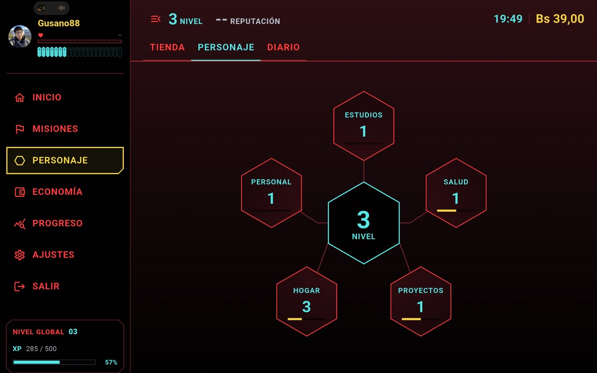
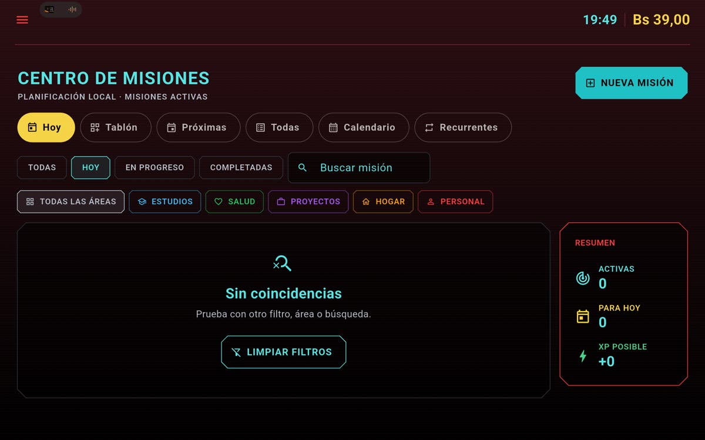
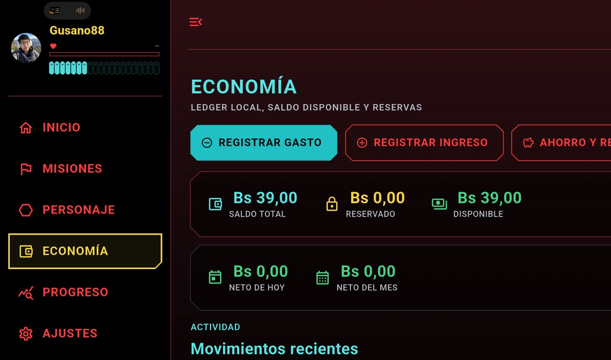
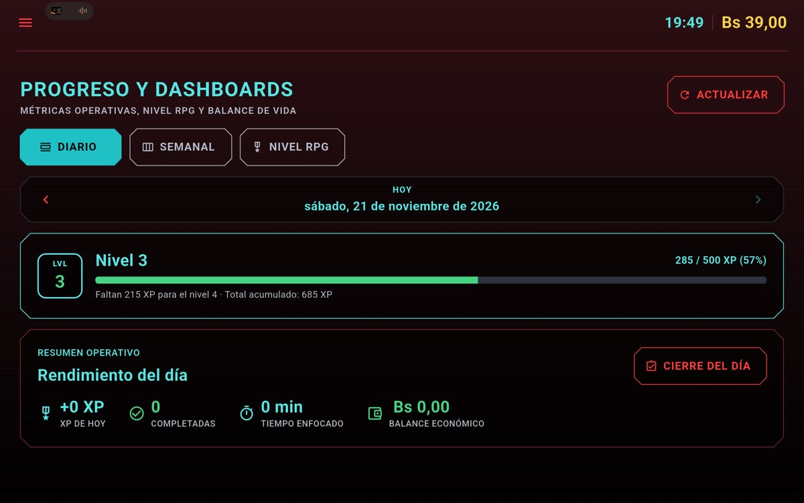
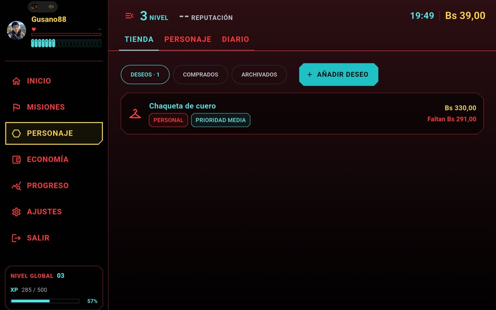
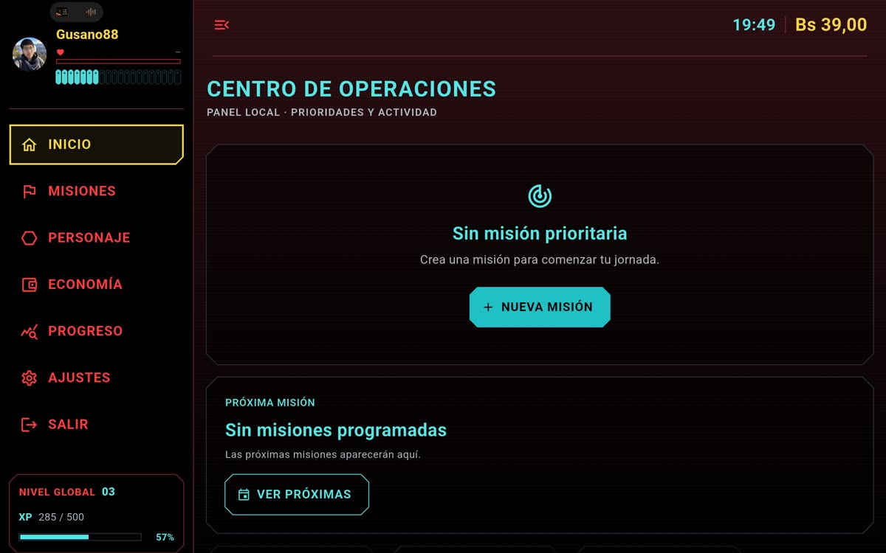

# Bitácora RPG Personal

App Android que convierte la organización de tu vida en un **juego de rol**: tus tareas son misiones, ganas XP al completarlas
y cada área de tu vida (estudios, salud, hogar, proyectos, personal) sube de nivel por separado.
También lleva tu economía, un diario y una lista de deseos, todo con estética **cyberpunk de terminal**.

Es **privada y sin internet**: los datos nunca salen del teléfono, la base de datos va cifrada y se entra con PIN o huella.

<p align="center">
  
</p>

## Capturas (tablet)

| Personaje | Misiones |
|---|---|
|  |  |
| El nivel global en el centro y un hexágono por cada área de la vida, cada una con su propio nivel. | Centro de misiones con vistas Hoy, Tablón, Próximas, Calendario y Recurrentes, filtros por área y un resumen de XP posible. |
| **Economía** | **Progreso** |
|  |  |
| Saldo total, reservado y disponible. Cada gasto o ingreso pasa por un libro contable (*ledger*), nunca se edita el saldo a mano. | Paneles diario, semanal y de nivel RPG: XP, misiones completadas, tiempo enfocado y balance del día. |
| **Tienda de deseos** | **Inicio** |
|  |  |
| Lista de cosas que quieres comprar, con prioridad y cuánto te falta según tu saldo real. | Centro de operaciones: la misión prioritaria del momento y la próxima programada. |

## Qué hace

- **Misiones** únicas y recurrentes, con prioridad, importancia, cronómetro, recordatorios y un tablón diario para tomar tareas sin llenar el día de antemano.
- **Progreso RPG:** XP, niveles globales y por área, títulos y rachas.
- **Economía personal:** gastos, ingresos, reservas y metas de ahorro.
- **Diario** con estados de ánimo y fotos, enlazable con misiones y movimientos.
- **Personajes:** fichas de las personas de tu vida, vinculadas a misiones y entradas del diario.
- **Tienda de deseos** conectada a tu saldo disponible.
- Interfaz adaptable a **teléfono y tablet**, con barra lateral, perfil y batería real en tablet.

## Privacidad y seguridad

- Funciona **100 % sin conexión**: no hay servidor ni cuentas.
- Base de datos **SQLite cifrada** (SQLite3 Multiple Ciphers). La clave se guarda en el **Android Keystore**.
- Acceso con **PIN** (con un teclado numérico propio, sin el teclado del sistema), recuperación y **biometría** opcional.
- Bloqueo automático, **bloqueo de capturas de pantalla** y notificaciones que ocultan el título de la misión por defecto.

## Cómo está hecho

| Parte | Tecnología |
|---|---|
| App | Flutter 3.41 · Dart 3.11 |
| Estado y navegación | Riverpod · GoRouter |
| Base de datos | Drift sobre SQLite cifrado, con migraciones probadas del esquema v1 al actual |
| Android nativo | Kotlin: Keystore, alarmas que sobreviven al reinicio, notificaciones, sonidos y batería |
| Arquitectura | *Clean Lite* organizada por funcionalidad (*feature-first*): el dominio no depende de Flutter ni de la base de datos |
| Calidad | Más de 400 pruebas (unitarias, de widgets, *golden* e integración) |

El proyecto se planificó con documentos de especificación, UML y decisiones de arquitectura (ADR) antes de escribir código.
Todo está en [`documentos/`](documentos/), y el README técnico original (fases, verificación y firma de release) en
[`documentos/README-TECNICO.md`](documentos/README-TECNICO.md).

## Ejecutar

Requiere Flutter 3.41, JDK 17 y un dispositivo o emulador Android (API 24 o superior).

```bash
flutter pub get
flutter run --flavor dev -t lib/main_dev.dart
```

## Estado

Versión **1.8.0**, en uso diario en mi tablet. Lo siguiente en el plan: inventario y copia de seguridad.
